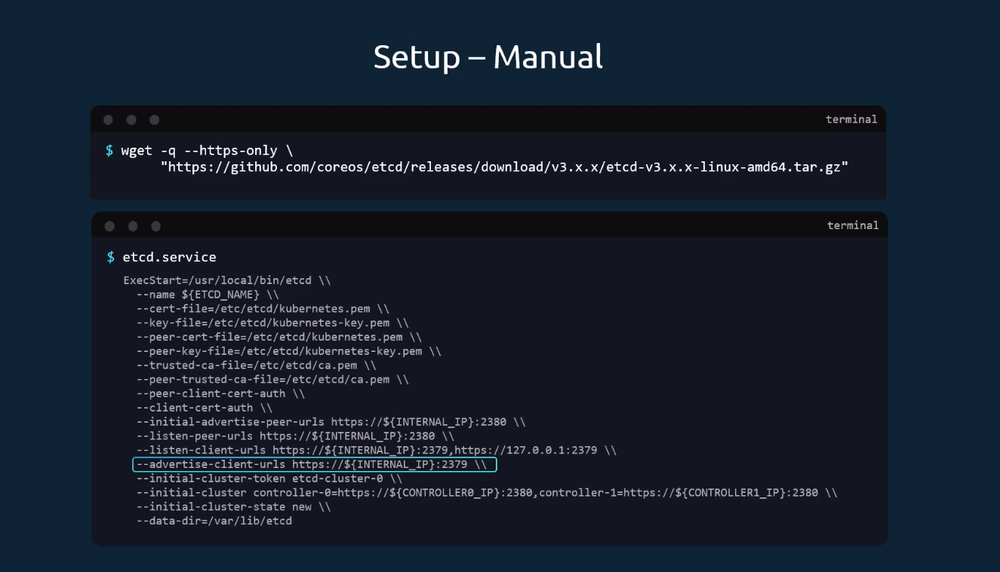
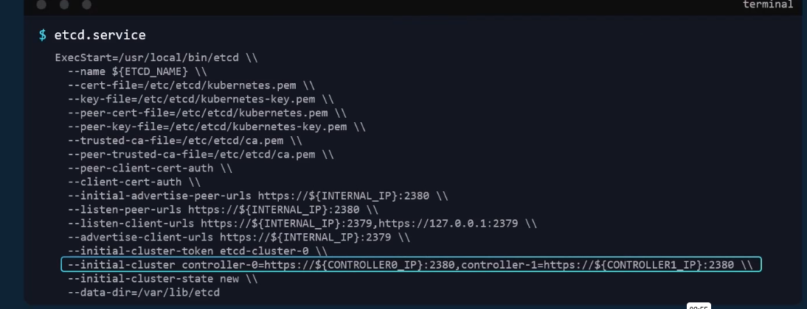
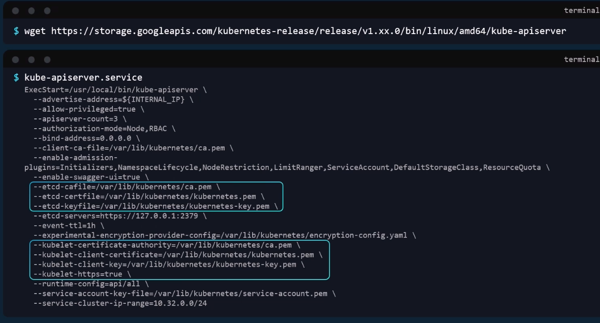
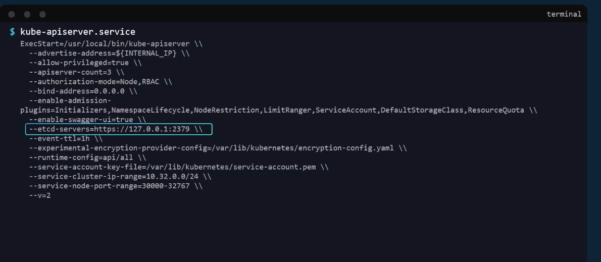
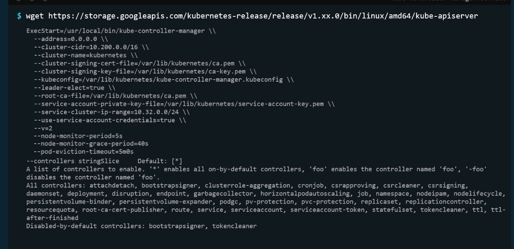
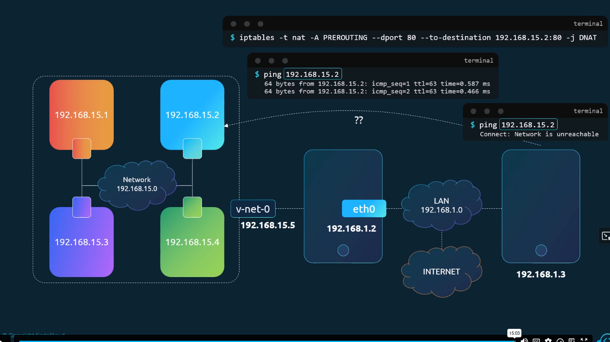
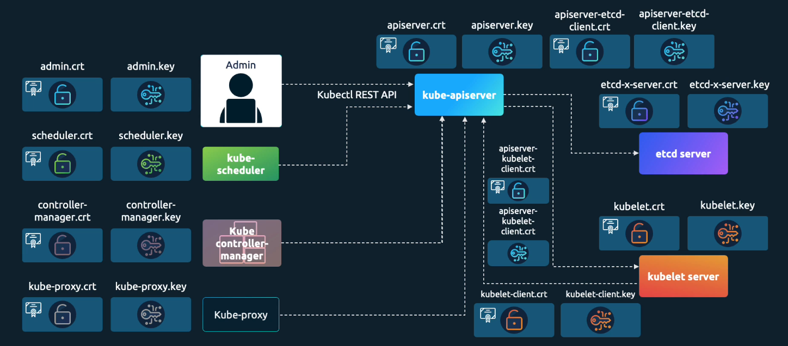

# CKA Preparation 
### CLI - nerdctl 
- nerdctl provides a Docker-like CLI for containerD 
- nerdctl supports docker compose. 
- nerdctl supports features in containerd
    - Encrypted container images. 
    - Lazy Pulling. 
    - P2P image distribution 
    - image signing and verifying 
    - Namespaces in Kubernetes
### CLI - crictl
- crictl provides a CLI for CRI compatible container runtimes 
- Installed separately 
- Used to inspect and debug container runtimes 
    - Not to create container ideally. 
- Works aceoss differnet runtimes. 
- crictl pull busybox, crictl images, crictl ps -a, crictl exec -i -t <id container> ls, crictl logs <container image>, crictl pods. 
# docker vs crictl

## Retrieve debugging information

| docker cli | crictl | Description | Unsupported Features |
| --- | --- | --- | --- |
| `attach` | `attach` | Attach to a running container | `--detach-keys`, `--sig-proxy` |
| `exec` | `exec` | Run a command in a running container | `--privileged`, `--user`, `--detach-keys` |
| `images` | `images` | List images | |
| `info` | `info` | Display system-wide information | |
| `inspect` | `inspect`, `inspecti` | Return low-level information on a container, image or task | |
| `logs` | `logs` | Fetch the logs of a container | `--details` |
| `ps` | `ps` | List containers | |
| `stats` | `stats` | Display a live stream of container(s) resource usage statistics | Column: NET/BLOCK I/O, PIDs |
| `version` | `version` | Show the runtime (Docker, ContainerD, or others) version information | |
# docker vs crictl

## Perform Changes

| docker cli | crictl | Description | Unsupported Features |
|---|---|---|---|
| `create` | `create` | Create a new container | |
| `kill` | `stop (timeout = 0)` | Kill one or more running container | `--signal` |
| `pull` | `pull` | Pull an image or a repository from a registry | `--all-tags`, `--disable-content-trust` |
| `rm` | `rm` | Remove one or more containers | |
| `rmi` | `rmi` | Remove one or more images | |
| `run` | `run` | Run a command in a new container | |
| `start` | `start` | Start one or more stopped containers | `--detach-keys` |
| `stop` | `stop` | Stop one or more running containers | |
| `update` | `update` | Update configuration of one or more containers | `--restart`, `--blkio-weight` and some other resource limit not supported by CRI. |
 
 | Purpose | Debugging | General Purpose | Debugging |
|---|---|---|---|
| **Community** | ContainerD | ContainerD | Kubernetes |
| **Works With** | ContainerD | ContainerD | All CRI Compatible Runtimes |

# etcd : is key value for storing information about the state of the cluster. 
- the following command used to interact with the etcd : ./etcdctl 

- set up the cluster with kubeadm find the information about etcd with following command : kubectl get pods -n kube-system 
- To list all keys of the keys stored in the etcd we kan use the following command : kubectl exec etcd-master -n kube-system etcdctl get / --prefix -keys-only 
- etcd in HA Environment : set the right parametres in the etcd configuration : 

- ETCDCTL is the CLI tool used to interact with ETCD.ETCDCTL can interact with ETCD Server using 2 API versions – Version 2 and Version 3. By default it’s set to use Version 2. Each version has different sets of commands.

- For example, ETCDCTL version 2 supports the following commands:
    - etcdctl backup
    - etcdctl cluster-health
    - etcdctl mk
    - etcdctl mkdir
    - etcdctl set
- Whereas the commands are different in version 3 
    - etcdctl snapshot save
    - etcdctl endpoint health
    - etcdctl get
    - etcdctl put
- To set the right version of API set the environment variable ETCDCTL_API command
    - export ETCDCTL_API=3
- When the API version is not set, it is assumed to be set to version 2. And version 3 commands listed above don’t work. When API version is set to version 3, version 2 commands listed above don’t work.

- Apart from that, you must also specify the path to certificate files so that ETCDCTL can authenticate to the ETCD API Server. The certificate files are available in the etcd-master at the following path. We discuss more about certificates in the security section of this course. So don’t worry if this looks complex:

    - --cacert /etc/kubernetes/pki/etcd/ca.crt
    - --cert /etc/kubernetes/pki/etcd/server.crt
    - --key /etc/kubernetes/pki/etcd/server.key
- So for the commands, I showed in the previous video to work you must specify the ETCDCTL API version and path to certificate files. Below is the final form:
- kubectl exec etcd-controlplane -n kube-system -- sh -c "ETCDCTL_API=3 etcdctl get / \
  - --prefix --keys-only --limit=10 / \
  - --cacert /etc/kubernetes/pki/etcd/ca.crt \
  - --cert /etc/kubernetes/pki/etcd/server.crt \
  - --key /etc/kubernetes/pki/etcd/server.key"
# Kube-apiserver : 
- Authenticate User 
- Validate Request 
- Retrieve data 
- Update ETCD 
- Scheduler 
- Kubelet 
## installing kube-apiserver : 


- Viewing apiserver - kubeadm
    - kubectl get pods -n kube-system
- viewing apiserver Options - kubeadm 
    - cat /etc/kubernetes/manifests/kube-apiserver.yaml 
- Viewing apiserver Options 
    - cat /etc/systemd/system/kube-apiserver.service
    - ps -aux | grep kube-apiserver

## Kube Controller Manager : 
- Controller is the process that continously monitors the state of various componenent in the system and works towards bringing the whole sytem to the desired state. 
- Watch status 
- Remeduate Situation 
- Node Monitor Period = 5s 
- Node Monitor Grace Period = 40s 
- Pod Eviction Timeout = 5min 
- Installing kube-controller-manager : 

- viewing kube-controller-manager-kubeadm4
    - kubectl get pods -n kube-system
    - ps -aux | grep kube-controller-manager 

## kube scheduler 
- Viewing kubescheduler Options - kubeadm
    - cat /etc/kubernetes/manifests/kube-scheduler.yaml 
    - ps -aux | grep kube-scheduler
 ## Kubelet
- ps -aux | grep kubelet
## kube-proxy 
- kubectl get pods -n kube-system
- kubectl get daemonset -n kube-system 
## Pods : 
 # Pod Definition

```yaml
apiVersion: v1
kind:
metadata:
    name: myapp-pod
    type: front-end 
spec:
    containers: 
    - name: nginx-container
      image: nginx 

kubectl create -f pod-definition.yml 
kubectl get pods
kubectl describe pod myapp-pod  
### API Versions by Kind
| Kind | Version |
|---|---|
| Pod | `v1` |
| Service | `v1` |
| ReplicaSet | `apps/v1` |
| Deployment | `apps/v1` |
```
## ReplicaSets 
### replication-controller
``` yaml
rc-definition.yml 
apiVersion: v1
kind: ReplicationController
metadata: 
    name: myapp-rc
    labels
        app: myapp 
        type: front-end
spec:
  - template: 
        metadata: 
          name: myapp-pod
          labels: 
            app: myapp
            type: front-end
        spec: 
          containers: 
          - name: nginx-container
            image: nginx 
  replicas: 3    
```
### replicaset-definition.yml 
``` yaml
apiVersion: apps/v1
kind: ReplicatSet
metadata: myapp-replicaset
    name: myapp
    type: front-end
spec: 
  template: 
    metadata: 
      name: myapp-pod
      labels: 
        app: myapp
        type: front-end
    spec:
      containers: 
      - name: nginx-container
        image: nginx 
  replicas: 3
  selector:
    matchLabels: 
        type: front-end
```
- How to update and the scale the replicaset : 
    - kubectl create -f replicaset-definition.yml
    - kubectl scale --replicas=6 -f replicatset-definition.yml
    - kubectl scale --replicas=6 replicaset  myapp-replicaset
- commands : 
    kubectl replace -f replicaset-definition.yml 
## deployments: 
- rolling updates 
- rolle back 

``` yaml
apiVersion: apps/v1
kind: Deployment
metadata: 
  name: myapp-deployment
  labels: 
      app: myapp
      type: front-end
spec: 
  template: 
    metadata: 
      name: myapp-pod
      labels: 
          app: myapp
          type: front-end
    spec: 
      containers:
      - name: nginx-container
        image: nginx
replicas: 3
selector: 
    matchlabels: 
        type: front-end 
```
- kubectl get all 
- Create an NGINX Pod
    - kubectl run nginx --image=nginx
- Generate POD Manifest YAML file (-o yaml). Don’t create it(–dry-run)
    - kubectl run nginx --image=nginx --dry-run=client -o yaml
- Create a deployment
    - kubectl create deployment --image=nginx nginx
- Generate Deployment YAML file (-o yaml). Don’t create it(–dry-run) :
    - kubectl create deployment --image=nginx nginx --dry-run=client -o yaml
- Generate Deployment YAML file (-o yaml). Don’t create it(–dry-run) and save it to a file.
    - kubectl create deployment --image=nginx nginx --dry-run=client -o yaml > nginx-deployment.yaml
- Make necessary changes to the file (for example, adding more replicas) and then create the deployment.
    - kubectl create -f nginx-deployment.yaml
- In k8s version 1.19+, we can specify the –replicas option to create a deployment with 4 replicas: 
    - kubectl create deployment --image=nginx nginx --replicas=4 --dry-run=client -o yaml > nginx-deployment.yaml
## services: 
- kubernetes service enable communication between various compenent within and outside of the application. 
- helps us to connect application with other application or users. 
- service enable connectivite between the pods. 
## service - NodePort
- NodePort : range: 30000-32767 
- service-definition.yml 
``` yaml
apiVersion: v1
kind: Service
metadata: 
    name: myapp-service
spec:
    type: NodePort
    ports:
      - targetPort: 80
        port: 80
        nodePort: 30008
    selector: 
       app: myapp
       type: front-end 
```
## ClusterIp services : 
``` yaml
apiVersion: v1 
kind: Service 
metadata: 
    name: back-end 
spec: 
    type: ClusterIP
    ports: 
     - targetPort: 80
       port: 80 
    selector:
        app: myapp
        type: back-end
```
### Services Loadbalancer: 
``` yaml
apiVersion: v1
kind: Service
metadata: 
    name: myapp-service
spec: 
    type: LoadBalancer
    ports: 
     - targetPort: 80
       port: 80
       nodePort: 30008
```
### Namespace - Isolation
- kube-system
- default 
- kube-public 
- connect to a service from default namespace that exist in another namespace for example dev namespace : we can use it like following 
    - mysql.connect("db-service.dev.svc.cluster.local")
- create Namesapce using yaml file: 
``` yaml
apiVersion: v1
kind: Namespace
metadata: 
    name: dev
```
- to switch from the default namespace to another namespace we can use the following command 
    - kubectl config set-context $(kubectl config current-context) --namespace=dev
## Ressource quota: 
``` yaml
apiVersion: v1
kind: ResourceQuota
metadata: 
    name: compute-quota
    namespace: dev

spec: 
  hard: 
    pods: "10"
    requests.cpu: "4"
    requests.memory: 5Gi
    limits.cpu: "10"
    limits.memory: 10Gi
```
- kubectl create -f compute-quota.yaml 
- generate the template of the pod using command line 
    - kubectl run redis \
  --image=redis \
  -n finance \
  --dry-run=client -o yaml > redis.yaml
-  list pods that exist on all namespaces : 
    - kubectl get pods --all-namespaces

###   Imperative vs Declarative 
## Infrastructure as Code : 
- Imperative: 
    - 1. Provision a VM by the name `web-server`
    - 2. Install NGINX Software on it
    - 3. Edit configuration file to use port `8080`
    - 4. Edit configuration file to web path `/var/www/nginx`
    - 5. Load web pages to `/var/www/nginx` from GIT Repo - X
    - 6. Start NGINX server
- Declarative: 
    - **VM Name:** web-server
    - **Package:** nginx
    - **Port:** 8080
    - **Path:** /var/www/nginx
    - **Code:** GIT Repo - X
- --dry-run By default as soon as the command is run, the resource will be created. If you simply want to test your command, use the --dry-run=client option. This will not create the resource; instead, it tells you whether the resource can be created and if your command is right.

- -o yaml This will output the resource definition in YAML format on the screen.

- Use the above two in combination to generate a resource definition file quickly that you can then modify and create resources as required instead of creating the files from scratch. 
### POD

- Create an NGINX Pod 
- kubectl run nginx --image=nginx
- Generate POD Manifest YAML file (-o yaml). Don’t create it(–dry-run)
    - kubectl run nginx --image=nginx --dry-run=client -o yaml
### Deployment
- Create a deployment
    - kubectl create deployment --image=nginx nginx
- Generate Deployment YAML file (-o yaml). Don’t create it(–dry-run) 
    - kubectl create deployment --image=nginx nginx --dry-run=client -o yaml
- Generate Deployment with 4 Replicas 
    - kubectl create deployment nginx --image=nginx --replicas=4
- You can also scale a deployment using the
    - kubectl scale deployment nginx--replicas=4
- Another way to do this is to save the YAML definition to a file and modify 
    - kubectl create deployment nginx --image=nginx --dry-run=client -o yaml > nginx-deployment.yaml
### Service 
- Create a Service named redis-service of type ClusterIP to expose pod redis on port 6379
    - kubectl expose pod redis --port=6379 --name redis-service --dry-run=client -o yaml :  (This will automatically use the pod’s labels as selectors)
    - or kubectl create service clusterip redis --tcp=6379:6379 --dry-run=client -o yaml: (This will not use the pods labels as selectors, instead, it will assume selectors as app=redis. 
- Create a Service named nginx of type NodePort to expose pod nginx’s port 80 on port 30080 on the nodes:
    - kubectl expose pod nginx --type=NodePort --port=80 --name=nginx-service --dry-run=client -o yaml
    - Or kubectl create service nodeport nginx --tcp=80:80 --node-port=30080 --dry-run=client -o yaml
    - Both the above commands have their own challenges. While one of them cannot accept a selector, the other cannot accept a node port. I would recommend going with the kubectl expose 

###  Kubectl command 
- you can use the following command to list all the resources in k8s : kubectl api-resources
- to explain the command and get more information u can use the following command : kubectl explain resource to get more the details u can use .spec and if u u want more comprehensive u can use the following flag --recursive 
-----------------------------------------------------------------------------------------------------------------------------------------------------------------------------------------------------------
# Scheduling 
## Manual scheduling: 
- if the scheduler dosn't exist by default u can do it in two ways 
    - 1 u can define the node that u want ur pod to be in by using it in the pod defenition yaml 
``` yaml
apiVersion: v1
kind: Pod 
metadata: 
    name: nginx
    labels: 
       name: nginx
spec: 
   containers: 
   - name: nginx
     ports:
     - conainerPort: 8080
   nodeName: node02
```
- Or if the already exist u can use the pod bind definition  by creatinf a yaml file like this : 
``` yaml 
apiVersion: v1
kind: binding 
metadata: 
   name: nginx
target: 
   apiVersion: v1
   kind: Node
   name: node02
```
- And convert the yaml file and put it in the header of the curl to solicitate the api resource like that : 
- curl --header "Content-Type:application/json" --request POST --data{"apiVersion":"v1", "kind": "binding"...} http://$SERVER/api/v1/namespaces/default/pods/$PODNAME/binding/
## Labels and Selectors 
### Replicaset 
``` yaml 
apiVersion: apps/v1
kind: ReplicaSet
metadata: 
    name: simple-app
    labels: 
        app: App1
        function: Front-end
    annotations: 
            buildversion: 1.34
spec: 
  replicas: 3
  selector: 
     matchLabels: 
        app: App1
  template:
     metadata: 
        labels: 
          app: App1
          function:  Front-end
    spec: 
       containers: 
       - name: simple-webapp
         image: simple-webapp 
```
### Taints and Tolerations 
- we taint the node and we tolerant the pod 
- we can taint a node using the following command : kubectl taint node-name key=value:taint-effect 
- there is three type of tiant-effect: 
    - NoSchedule: the gonna not be schedule in the node if it is not tolerent 
    - preferNoSchedule: the sysstem does not garant that the pod not gonna schedule the pod in the node 
    - NoExecute; if a pod exist in the node and it is not tolerent gonna be evicted. 
- example kubectl taint nodes node1 app=myapp:Noschedule. 
- Tolerations PODs
    - we take the values that we gived when we tainted the node : kubectl taint nodes node1 app = blue : NoSchedule
    - and we put in the yaml file of the pod that we wanna tolerant 
``` yaml 
apiVersion: v1 
kind: Pod
metadata: 
    name: myapp-pod
    spec: 
    containers: 
    - name: nginx-container
      image: nginx
    tolerations: 
      - key: "app"
        operator: "equal"
        value: "blue"
        effect: "NoSchedule" 
```
- when installing kubernetes a taint is seted up to prevent scheduling pods in master node. 
    - to see this taint u can use the following command : kubectl describe node kubemaster | grep Taint
- controlplane ~ ➜  kubectl describe node node01 | grep Taints  
### Node Selectors 
- pod-defenition.yaml 
``` yaml 
apiVersion:
kind: pod 
metadata: 
   name: myapp-pod
spec: 
  containers: 
  - name: data-processor
    image: data-processor
  nodeSelector: 
      size: Large
``` 
- To label a node we can use the following command 
    - kubectl label nodes <node-name> <label-key>=<label-value>
        - example : kubectl label nodes node-1 size=Large 
### Node Addinity : POSs to Nodes 
``` yaml 
apiVersion: 
kind: Pod 
metadata: 
  name: myapp-pod
spec: 
  containers:
  - name: data-processor
    image: data-processor
  affinity:
   nodeAffinity:
    requiredDuringSchedulingIgnoreDuringExecution:
     nodeSelectorTerms:
     - matchSelectorTerms:
     - matchExpressions:
       - key: size
         operator: In  # or NotIn 
         values:
         - Large
```
### Node Affinity Types
- Available 
    - requiredDuringSchedulingIgnoredDuringExecution: if the node label dosn't exist the pod not gonna be scheduled.
    - preferredDuringSchedulingIgnoredDuringExecution: we tell to kubernetes do your best to schedule it in the right node if doesn't exist you can schedule it in any other node. 
### Resource Requirements 
``` yaml 
apiVersion: v1
kind: Pod 
metadata: 
   name: simple-webapp-color
   labels:
      name: simple-webapp-color
spec: 
   containers: 
   - name: simple-webapp-color
     image: simple-webapp-color
     ports:
       - containerPort: 8080
    resources: 
      requests: 
         memory: "1Gi"
         cpu: 2
       limits:
          memory: "2Gi"
          cpu: 2
```
- if the pod try to consume memory more than it's limit gonna terminated with OOM (Out of Memory).
# Behavior CPU 
- No request no limits : the pod can consume all the reources and the prevent the other pod from consuming the resources. 
- No request limits in this case Request=limits 
- Request limits : in this case the pod define it's resource and can't bypass it's limits. 
- Requests No Limits: this the ideal scenario when each pod garantie it's resources and there is any pod need more resources and there is resources free the pod can use this resource but if a pod has deffined request the pod that use more than his request gonna donwgrade his resources to free some cpus to the request of the pod.
- LimitRange for cpu in the namespace: 
``` yaml 
apiVersion: v1
kind: LimitRange
metadata: 
    name: cpu-resource-constraint
spec: 
   limits: 
   - default: 
        cpu: 500m
     defaultRequest: 
        cpu: 500m
     max: 
        cpu: "1"
     min: 
        cpu: 100m
     type: 
        Container
```
- LimitRange for memory in the namespace: 
``` yaml 
apiVersion: v1
kind: LimitRange
metadata: 
    name: memory-resource-constraint
spec: 
   limits: 
   - default: 
        memory: 1Gi
     defaultRequest: 
        memory: 1Gi
     max: 
        memory: 1Gi
     min: 
        memory: 500Mi
     type: 
        Container
```
- Resource Quotas by namespace 
``` yaml 
apiVersion: v1
kind: ResourceQuota
metadata: 
    name: my-resource-quota
spec: 
   hard: 
      requests.cpu: 4
      requests.memory: 4Gi
      limits.cpu: 10 
      limits.memory: 10Gi 
```
### Edit a Pod
- Remember, you CANNOT edit specifications of an existing Pod other than the below.

    - spec.containers[*].image
    - spec.initContainers[*].image
    - spec.activeDeadlineSeconds
    - spec.tolerations
- For example, you cannot edit the environment variables, service accounts, and resource limits (all of which we will discuss later) of a running pod. But if you really want to, you have 2 options:
- 1. Run the kubectl edit pod command. This will open the pod specification in an editor (vi editor). Then edit the required properties. When you try to save it, you will be denied. This is because you are attempting to edit a field on the pod that is not editable.
- A copy of the file with your changes is saved in a temporary location as shown above.
- You can then delete the existing pod by running the command:
    - kubectl delete pod webapp
- Then create a new pod with your changes using the temporary file
    - kubectl create -f /tmp/kubectl-edit-ccvrq.yaml
- 2. The second option is to extract the pod definition in YAML format to a file using the command
    - kubectl get pod webapp -o yaml > my-new-pod.yaml
- Then make the changes to the exported file using an editor (vi editor). Save the changes
    - vi my-new-pod.yaml
- Then delete the existing pod
    - kubectl delete pod webapp
- Then create a new pod with the edited file
    - kubectl create -f my-new-pod.yaml
- Edit Deployments
    - With Deployments, you can easily edit any field/property of the Pod template. Since the pod template is a child of the deployment specification, with every change the deployment will automatically delete and create a new pod with the new changes. So if you are asked to edit a property of a Pod part of a deployment you may do that simply by running the command
    - kubectl edit deployment my-deployment
### DaemonSets 
- Ensure that the pod is deployed in each node of the cluster. 
- use cases : Monitoring Solutions, Logs Viewer,  kube-proxy, calico. 
- daemon-set-definition.yaml
``` yaml 
apiVersion: apps/v1
kind: DaemonSet
metadata: 
    name: monitoring-daemon
spec: 
   selector: 
      matchLabeels: 
          app: monitoring-agent
    template: 
      metadata: 
         labels: 
           app: monitoring-agent
      spec: 
         containers: 
         - name: monitoring-agent
           image: monitoring-agent 
```
### Networking : 
- When we are in the same network we can find network interface using the following command : 
    - ip link 
- and if have two device in the same network and we want to comminicate this two device we can add ip of each using the following commande ip addr add <ip/subnet> dev eth0
- route command to the routes that we have and we can comminicate whith 
- to tell the network we can tell that this network interface can reach the other interface setting in other area we can use the command : ip route add 192.168.2.0/24 via 192.168.1.1
    - ip route add default via 192.168.2.1
- cat /proc/sys/net/ipv4/ip_forward
### Prequistes DNS: 
- we can give the entry point to the dns service in this folder /etc/resolv.conf
- we define the prority of the resolution of dns in this file /etc/nsswitch.conf
- A web-server  192.168.1.1
- AAAA web-server  ipv6
- CNAME food.web-server  eat.web-server, hungry.web-server
- for resolotion of dns we can use tools like dig nslookup 
- In the previous lecture, we saw why you need a DNS server, how it can help manage name resolution in large environments with many hostnames and Ips, and how you can configure your hosts to point to a DNS server. In this article, we will see how to configure a host as a DNS server.

- We are given a server dedicated as the DNS server and a set of IPs to configure as entries in the server. There are many DNS server solutions out there; in this lecture, we will focus on a particular one – CoreDNS.

- So, how do you get core DNS? CoreDNS binaries can be downloaded from their Github releases page or as a docker image. Let’s go the traditional route. Download the binary using curl or wget. And extract it. You get the coredns executable

- $ curl -LO https://github.com/coredns/coredns/releases/download/v1.12.4/coredns_1.12.4_linux_amd64.tgz
- $ tar -zxf coredns_1.12.4_linux_amd64.tgz 

- Run the executable to start a DNS server. It, by default, listens on port 53, which is the default port for a DNS server.

- Now, we haven’t specified the IP to hostname mappings. For that, you need to provide some configurations. There are multiple ways to do that. We will look at one.

- First, we put all of the entries into the DNS servers /etc/hosts file. Then, we configure CoreDNS to use that file. CoreDNS loads its configuration from a file named Corefile.

- Here is a simple configuration that instructs CoreDNS to fetch the IP to hostname mappings from the file /etc/hosts. When the DNS server is run, it now picks the IPs and names from the /etc/hosts file on the server.

- .:53 {
    # Use /etc/hosts to resolve hostname
    hosts /etc/hosts {
        reload 1m
        fallthrough
    }

    # Forward unmatched queries to the host's resolver
    forward . /etc/resolv.conf {
       max_concurrent 1000
    }
    cache 30
    log
    errors
}

- CoreDNS also supports other ways of configuring DNS entries through plugins. We will look at the plugin that it uses for Kubernetes in a later section.

- Read more about CoreDNS here:

- https://github.com/kubernetes/dns/blob/master/docs/specification.md

- https://coredns.io/plugins/kubernetes/
### Network Namespaces: 
- to create namespace in linux we can use the following command : ip netns add red 
- ip netns add blue 
- to list the name space u can run the following command : ip netns
- to see the network interfaces of a namespace we can use the following command : ip netns exec red ip link 
- arp to see the route table 
- to peer two namespaces we can use the following command: ip link add veth-red type veth name veth-bleu
- and to attach it to the borns we can use the following command: ip link set veth-red netns red similair for the blue ip link set veth-blue netns blue. 
- ip -n red addr add 192.168.15.1 dev veth-red
- ip -n blue addr add 192.168.15.2 dev veth-blue 
- ip -n red link set veth-red up 
- ip -n blue link set veth-blue up 
- we gonna use linux bridge
    - using the following command : ip link v-net-0 type bridge 
- to bring it up we can use the following command : ip link set dev v-net-0 up 
- we make the link the same like we did early and we peer it like this : ip link set veth-red-br master v-net-0
- and finaly to ping other we shoul add adress to v-net-0 : ip addr add 192.168.15.5/24 dev v-net-0
- to access another device that exist in our lan we can use the following command: ip netns exec blue ip route add 192.168.1.0/24 via 192.168.15.5 
- and now we should add nat to get response like this iptables -t nat -A POSTROUTING -s 192.168.15.0/24 -j MASQUERADE
- and suppose that the NAT access to the internet how we can make the ns reach the internet ? 
- so we should add default gateway using this command : ip netns exec blue ip route add default via 192.168.15.5
- to access the blue namespace from the outside from another network we can use the following command iptables -t nat -A PREROUTING --dport 80 --to-destination 192.168.15.2:80 -j DNAT

- While testing the Network Namespaces, if you come across issues where you can't ping one namespace from the other, make sure you set the NETMASK while setting IP Address. ie: 192.168.1.10/24

- ip -n red addr add 192.168.1.10/24 dev veth-red Another thing to check is FirewallD/IP Table rules. Either add rules to IP Tables to allow traffic from one namespace to another. Or disable IP Tables all together (Only in a learning environment).
### Docker Network: 
- if u run docker with none netwotk the containers can't comminicate with each other and outside : docker run --network none nginx 
- with host network the container is attached to the host there is no isolation betwen the host and the container docker run --network host nginx 
- with bridge that have 172.17.0.0 each container have its own private network 
### CNI Container Networking Interface (CNI)
- Container Runtime must create network namespace 
- identify the network the container must attach to 
- Container Runtime to incoke Network Plugin (bridge) when container is ADDed
- Container Runtime to invoke Network Plugin (bridge) when container is deleted
- Json format of the Network Configuration. 
- At the plugin : 
    - Must support command line arguments ADD/DEL/CHECK
    - Must support parametrs container id, networkns, etc. 
    - must manage IP Address assignment to PODs 
    - Must return in specific format 
### Networking Cluster Nodes 
- kube-controller-manager : 10257 
- kube-api : 6443
- kubelet: 10250
- kubescheduler: 10259
- etcd: 23780
- kubelet : 10250
- Services: 30000-32767
### Pod Networking 
- Networking model: 
    - Every Pod should have an Ip Address 
    - Every POD should be able to communicate with every POD in the same node
    - Every POD should be able to communicate with every other POD on other nodes without NAT 
### CNI in kubernetes: 
- ls -l /etc/cni/net.d/ 
- find / -type f \( -name bridge -o -name loopback -o -name host-local \) 2>/dev/null
- ipam
    - cat /etc/cni/net.d/net-script.conf
### Service Networking 
- iptables -L -t nat | grep db-service 
- cat /var/log/kube-proxy.log 
### DNS in kubernetes 
- curl http://web-service.apps.svc.cluster.local
### CoreDNS in kubenrnets: 
- the emplacement of coreDns is /etc/coreedns/Corefile
- cat /var/lib/kublet/config.yaml
- cat /etc/resolv.conf
- host web-service 
- host web-service.default 
### Ingress: 
- Now, in k8s version 1.20+, we can create an Ingress resource in the imperative way like this:-
    - kubectl create ingress ingress-test --rule="wear.my-online-store.com/wear*=wear-service:80"
- for helm to find your artifact to install we can use the ArtifactHUB
    - helm repo add ingress-nginx <url>
    - helm repo ls 
    - helm repo update 
    - helm install nginx-ingress ingress-nginx/ingress-nginx 
    - abd this will triger a load balancer 
    -  helm status nginx-ingress
    - to check our dns if it's live we can use the following web site whatsmydns.net
### Security Primitives: 
- Secure hists
    - Password based authentication disabled 
    - ssh key based authentication 
- authentication: who can access? 
    - Static Token File
    - Certificates
    - External Authentication -LDAP
    - Service Accounts 
- authorization: What can they do ? 
    - RBAC AUTHORISATION 
    - Node Authorization 
    - ABAC Authorization
    - Webhook Mode
- Auth Mechanisms-Basic 
    - Kube-apiserver <------ --token-auth-file=user-token-details.csv 
    - curl -v -k https://master-node-ip:6443/api/v1/pods --header "Authorization: Bearer <value-of-token>
- notes : 
    - this is not a recommended authentication mechanism 
    - Consider volume mount while providing the auth file in a kubeadm setup 
    - set up Role-Based Authorization for new users
### TLS Certificates (Prerequisites) 
- openssl genrsa -out my-bank.key 1024 
- openssl rsa -in my-bank.key -pout > mybank.pem
- to sign certificate we can use the following command : 
    - openssl req -new -key my-bank.key -out my-bank.csr -subj "/C=US/ST=CA/O=MyOrg, Inc./CN=my-bank.com" 
### TLS in Kubernetes: 
- Certificate (Public Key): *.crt *.pem
    - server.crt
    - server.pem
    - client.crt
    - client.pem
- Private key: *.key *-key.pem
    - server.key
    - Server-key.pem
    - client.key
    - client.key.pem

