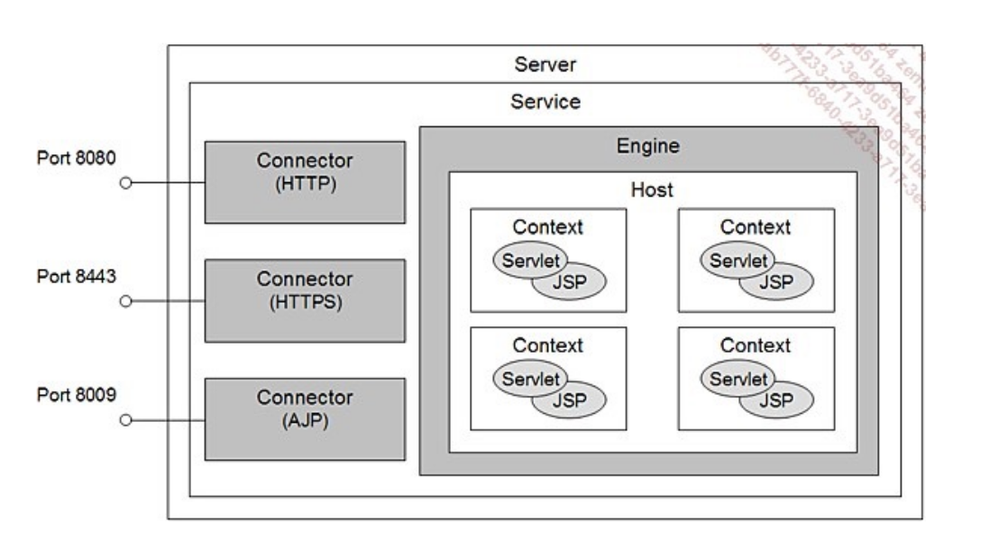

### APACHE httpd : 
## fichier de configuration: 
- Le fichie de configuration principale est /etc/apache2/apache2.conf il contient les paramètres g"n"reaux et communs à tous les serveurs et plusieurs "Include" vers les autres fichies. 
- le fichier de configuration /etc/apache2/ports.conf contient la liste des ports en écoute? 
- dans le dossier /etc/apache2/mods-available/ on trouve deux categorie de fichies *.load et */conf
    - les fichiers .load charge le modules dynamiques. 
    - et les fichies .conf sont les fichies de confuigaration des modules 
    - et les fichies des modules activés sont dans le dossier /etc/apache2/mods-enabled/ 
    - et pour créer un lien pour qu'il soit un modules activé on peut utulisé la commande suivantes a2enmod mod_userdir. 
    - on trouve les fichiers de configuration des sites web activés dans le répertoire /etc/apache2/sites-enabled/ ce sont uniquement les fichies qui sont inclus dans le fichier de configuration principale par la directive: Include /etc/apache2/sites-enbled/*.conf et ces fichies sont en fait des liens qui pointent vers les fichies de /etc/apahe2/sites-available/, de même pour activer un site, il existe une commande a2ensite fichier_conf 
- la documentation et dans /usr/share/doc
- les journaux sont dans /var/log/apache2
- le script de lancement du service du service serveur est dans /lib/systemd/system
- dans le fichier /etc/apache2/apache2.conf: 
    - www-data et group www-data spécifient le compte anonyme utilisé par le serveur une fois qu'il est lancé. ET POUR ACCÉDER aux ports inférieurs à 1024, le serveur utilise le compte administarateur. 
- ServerRoot /etc/apache2, indique l'adresse du répertoir racine du serveur, ou sont stockés les fichiers de configuartion du serveur HTTP
- PidFile /var/run/apache2.pid, indique le fichier ou le serveur en exécution stocke son némuro de processus (PID)
- ErrirLog est calculé à partir de serveur root logs/error_log 
- la configuratuin de Virtual host se fait dans les fichiers *.conf dans /etc/apache2/sites-available/ 
## Sécurisé la configuration de votre serveur web: 
- ubuntu regroupent les directives sensibles en terme de sécurité dans le fichier /etc/apach2/conf-available/security.conf. 
- la configuration qui donne la moindre d'informations :    
    - ServerTikens Prod
    - ServerSignature off 
- Apache permet de restreindre l'accès aux ressources sensibles. Les modes d'authentifications les plus courants sont contrainement par IP et par login/mot de passe 
    - commencez par créer les données à protéger. 
        - sudo mkdir /var/www/html/ web101 /top_secret
        - “voici mon secret” > /var/www/html/ web101 /top_secret/index.html
    - Pour protéger votre répertoire top_secret , ajoutez la section suivante à la configuration de votre
<--VirtualHost /--> dans /etc/apache2/sites-available/ZHE.conf et rechargez la configuration
Apache :
    - <--Directory /var/www/html/ web101 /top_secret>
AuthType Basic
AuthName “Accès restreint aux utilisateurs authentifiés”
AuthBasicProvider file
AuthUserFile “/etc/apache2/passwords”
Require valid-user
<--/Directory>
- Il vous faut donc maintenant créer ce fameux fichier de mots de passes grâce à la commande htpasswd :
- on peut utilisé cette commande pour voir qui utilise virtualhsot : sudo apache2ctl -S 
- cette commande utilmisé pour désactiver une site : sudo a2dissite 000-default.conf 
- et cette commande pour vérifier la syuntax c correcte : "sudo apache2ctl configtest"
- sudo a2enconf servername
### Sécurisez vos connexions grâce à HTTPS: 
- étape1 - activation de mod_ssl 
    - sudo a2enmod ssl 
- Rédemarrez Apache : 
    - sudo systemctl restart apache2
- crée la certif : 
    - sudo open req -x509 -nodes -days 365 -newkey rsa:2048 -keyout /etc/ssl/private/apache-selfsigned.key -out /etc/ssl/certs/apache-selfsigned.crt
---------------------------------------------------------------------------------------------------------------------
### Apache Tomcat: 

- la hierachie de conteneurs et de composants est représentée, d'un point de vue de la configuration, par le fichier server.xml qui est le principal fichier de configuration de tomcat.
- Ainsi le shéma precedent met en évidence les conteneurs Context, qui représentent les applications dans un conteneur host. 
## Arborescence de l’installation
- répertoire bin : les fichiers qui permettent de lancer Tomcat. 
- répertoir conf : contient les fichiers de configurations de tomcat. 
- répertoir lib: contient les librairies java dont Tomcat a besoin pour fonctionner
- répertoir log: Tomcat écrit ses fichiers de journalisation dans sa configuration par défaut. 
- répertoire temp: répertoir temporaire contenant des fichiers temporaires 
- Le répertoire webapp contient les applications web gérées par Tomcat. Cet endroit peut bien sûr être redéfini. Par
défaut, il contient cinq applications, très utiles lorsque l'on débute :
    - docs : contient les pages de documentation de Tomcat, également accessibles en ligne ;
    - exemples : contient des exemples simples de servlets et de pages JSP ;
    - host-manager et manager : contiennent l'application de gestion des applications web de Tomcat. Cette application permet de charger des applications web à chaud, et de les visualiser dans une interface web.
    - ROOT : racine des applications web chargées par défaut.
- Répertoire work : Répertoire de travail de Tomcat, dans lequel, entre autres, les classes Java correspondant aux pages JSP sont créées et compilées
### telecharger tomcat 
- commençant par créer un utilisateur pour tomcat : sudo useradd -m -d /opt/tomcat -U -s /bin/false tomcat
- installer le fichier : wget https://dlcdn.apache.org/tomcat/tomcat-10/v10.1.60/bin/apache-tomcat-10.1.60.tar.gz
- extraire les fichiers : sudo tar xzvf apache-tomcat-10*tar.gz -C /opt/tomcat --strip-components=1 
- ensuite, définissez les autorisations : 
    - sudo chown -R tomcat:tomcat /opt/tomcat/
    - sudo chmod -R u+x /opt/tomcat/bin
- créer l'utilisateur Tomcat dans le fichier : /opt/tomcat/conf/tomcat-users.xml 
``` xml
<?xml version='1.0' encoding='utf-8'?>
<tomcat-users>
<role rolename="manager"/>
<user username="admin" password="secret" roles="manager "/>
</tomcat-users>
```
- activer l'accès à distance à Tomcat 
    - Les applications Tomcat manager et host-manager par défaut sont accessibles uniquement pour localhost. Pour
autoriser l'accès à ces pages depuis le système distant, vous devez modifier les fichiers de configuration suivants.
    - /opt/tomcat/webapps/manager/META-INF/context.xml
    - Commentez la section ajoutée pour la restriction d'adresse IP afin d'autoriser les connexions de n'importe où. 
    - De la même manière, modifiez context.xml pour l'application Host Manager dans l'éditeur de texte :
    - sudo vim /opt/tomcat/webapps/host-manager/META-INF/context.xml
### Création de service systemd pour Tomcat
- Tomcat fournit des scripts bash pour démarrer, arrêter le service. Mais, pour simplifier, créez un script
de démarrage pour gérer Tomcat en tant que service systemd. Créons un fichier tomcat.service avec
le contenu suivant :
    - /etc/systemd/system/tomcat.service
``` xml 
[Unit]
Description=Tomcat
After=network.target
[Service]
Type=forking
User=tomcat
Group=tomcat
Environment="JAVA_HOME=/usr/lib/jvm/default-java"
Environment="JAVA_OPTS=-Djava.security.egd=file:///dev/urandom"
Environment="CATALINA_BASE=/opt/tomcat"
Environment="CATALINA_HOME=/opt/tomcat"
Environment="CATALINA_PID=/opt/tomcat/temp/tomcat.pid"
ExecStart=/opt/tomcat/bin/startup.sh
ExecStop=/opt/tomcat/bin/shutdown.sh
[Install]
WantedBy=multi-user.target
```
- recharger le service démon systemd pour charger les nouvelles crées : sudo systemctl daemon-reload
- maintenant démarré l'application tomcat pour la première fois : sudo systemctl start tomcat.service
- sudo systemctl status tomcat.service
- Le serveur Tomcat par défaut s'exécute sur le port 8080. Comme vous avez configuré Tomcat sur votre
système
- L'application Tomcat Host Manager est une autre application Web fournie avec l'application serveur Tomcat. Qui est
utilisé pour créer/supprimer des hôtes virtuels dans le service Tomcat. Un hôte virtuel vous permet de définir plusieurs noms d'hôtes sur un seul serveur.
### configuration de TOMCAT: 
- Le principal fichier de configuration de Tomcat 8 s’appelle server.xml et se trouve dans le
répertoire CATALINA_HOME/conf.
- Un connecteur est un objet Java capable d'écouter un port précis et comprenant un protocole précis. À
chaque protocole supporté par Tomcat est associé une classe Java de connecteur. Chaque connecteur dirige
ensuite les requêtes qu'il reçoit au moteur de servlets défini dans ce service
- enableLookups : autorise ou non les requêtes DNS lorsqu'une servlet invoque la
méthode request.getRemoteHost(). Une requête DNS est un processus éventuellement coûteux.
Si enableLookups est à false, alors request.getRemoteHost()retourne l'adresse IP plutôt que le nom de
domaine associé.
- maxPostSize : la taille maximale des requêtes POST supportée par ce serveur. La valeur par défaut est fixée
à 2Mo. Une valeur de -1 signifie qu'il n'y a pas de limite.
- Connecteur HTTP
    - Le connecteur HTTP supporte le standard HTTP/1.1, et permet à Tomcat de fonctionner comme un serveur web
    à part entière.
    - maxThreads : indique le nombre maximal de requêtes que ce connecteur peut traiter à la fois (une requête est
    traitée dans son propre thread par le connecteur HTTP). Au-delà de cette limite, les requêtes sont placées dans
    une file d'attente.
    - acceptCount : taille maximale de la file d'attente des requêtes. Si des requêtes supplémentaires arrivent, alors elles sont rejetées.
    - protocol : cet attribut peut prendre deux types de valeur, un nom de protocole, tel que HTTP/1.1
    Connecteur AJP
    - Le connecteur AJP communique avec un autre serveur web, en utilisant le protocole AJP. Il existe deux     connecteurs de ce type :
        - JK 1.2.* : permet de communiquer avec tous les serveurs web qui supportent le protocole JK ;
        - mod_proxy : permet de communiquer avec Apache 2.2.*.
- Élément Engine
    - L'élément Engine modélise le moteur de servlet proprement dit. À chaque serveur Catalina est associé un
    - unique moteur de servlet, auquel on accède via des connecteurs. Un moteur peut comporter plusieurs sous- éléments Host, chacune représentant un hôte virtuel.
- Toutes les implémentations par défaut de cet élément supportent les attributs suivants :
    - name : le nom de ce moteur, notammentutilisé dans les fichiers journal ;
    - defaultHost : l'hôte virtuel par défaut vers lequel diriger cette requête.
- Élément Host
- Cet élément modélise un hôte virtuel. Un hôte virtuel doit être associé à l'adresse IP de ce serveur, via un DNS
ou un fichier hosts. Si l'attribut defaultHost du moteur dans lequel se trouve cet hôte est défini, alors au
moins un des hôtes doit obligatoirement posséder ce nom.
Toutes les implémentations de Host doivent supporter les attributs suivants :
- name : le nom de cet hôte virtuel ;
- appBase : l' application base pour cet hôte. Il s'agit du répertoire contenant lesapplications web pour cet
hôte. Il peut s'agir d'un chemin absolu, ou d'un chemin relation au répertoire $CATALINA_BASE. La valeur par
défaut de cet attribut est true.
- autoDeploy : indique à Tomcat s'il doit charger automatiquement les applications web qui sont copiées dans
le répertoire appBase. Le cas échéant, Tomcat scrute le contenu de ce répertoire à intervalles de temps
réguliers, afin de détecter de nouveaux répertoires, ou de nouveaux fichiers .war.
- deployOnStartup : indique à Tomcat s'il doit charger les applications web se trouvant dans appBase lors de
son démarrage. La valeur par défaut de cet attribut est true.
- workDir : répertoire de travail propre à cet hôte. Par défaut, Catalina utilise un sous-répertoire
de $CATALINA_BASE/work pour chaque hôte, mais il est possible d'en choisir un autre. On peut accéder à ce
répertoire d'une servlet, via l'attribut d'application javax.servlet.context.tempdir.
- unpackWARs : indique à Catalina qu'il doit exécuter les applications web de cet hôte dans un répertoire de
travail avant de les exécuter. La valeur par défaut de cet attribut est true.
- deployXML : indique à Catalina s'il peut ou non prendre en compte les fichiers /META-INF/context.xml des
applications web. La valeur par défaut de cet attribut est true.